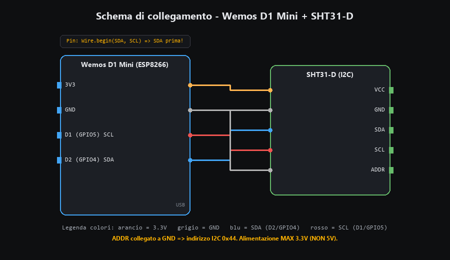
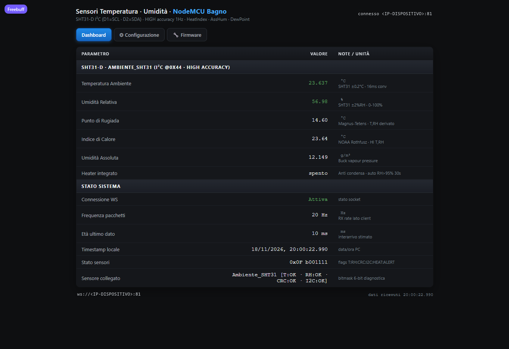
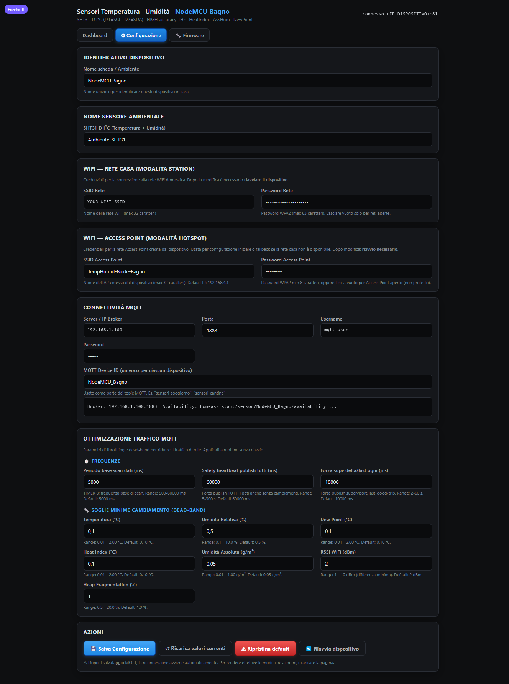
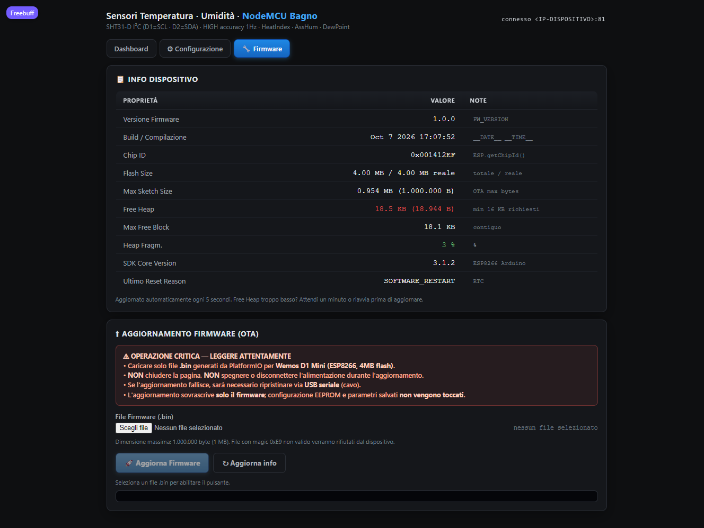
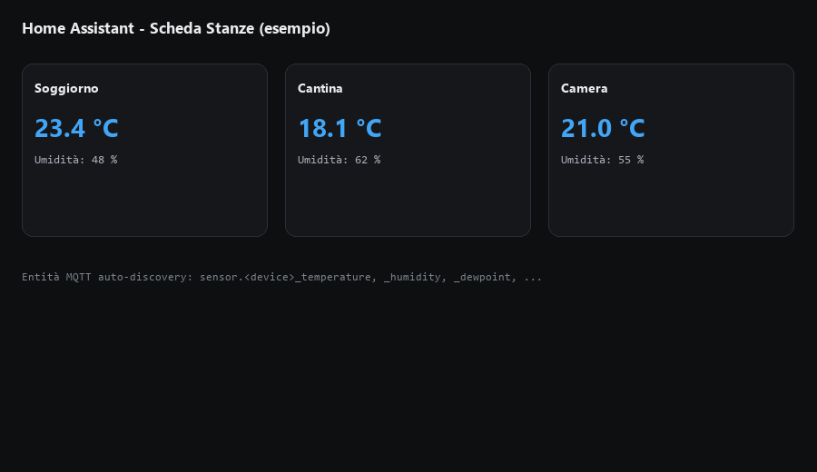

# NodeMCU Temperatura & Umidità — SHT31-D

[](https://platformio.org/)
[](https://www.wemos.cc/)
[](https://sensirion.com/products/catalog/SHT31-D/)
[]()

> Firmware per **Wemos D1 Mini (ESP8266)** che misura **temperatura** e **umidità** con il sensore ad alta precisione **SHT31-D**, calcola grandezze derivate (punto di rugiada, indice di calore, umidità assoluta) e pubblica i dati su **seriale, pagina web live, WebSocket e MQTT (Home Assistant)**, con **aggiornamento firmware OTA** e **crash logger** integrati.

---

## 📑 Indice

1. [Cos'è questo progetto (in parole semplici)](#cosè-questo-progetto-in-parole-semplici)
2. [Cosa misura](#cosa-misura)
3. [Cosa ti serve (hardware)](#cosa-ti-serve-hardware)
4. [Schema di collegamento](#schema-di-collegamento)
5. [Cosa ti serve (software)](#cosa-ti-serve-software)
6. [Installazione passo-passo](#installazione-passo-passo)
7. [Primo avvio e configurazione WiFi](#primo-avvio-e-configurazione-wifi)
8. [La dashboard web](#la-dashboard-web)
   - [Scheda Dashboard](#scheda-dashboard)
   - [Scheda Configurazione](#scheda-configurazione)
   - [Scheda Firmware (OTA)](#scheda-firmware-ota)
9. [Guida dettagliata alla configurazione](#guida-dettagliata-alla-configurazione)
10. [MQTT e Home Assistant](#mqtt-e-home-assistant)
11. [Aggiornamento firmware OTA (via web)](#aggiornamento-firmware-ota-via-web)
12. [Crash logger e diagnostica](#crash-logger-e-diagnostica)
13. [Risoluzione problemi (FAQ)](#risoluzione-problemi-faq)
14. [Struttura del progetto](#struttura-del-progetto)
15. [Crediti](#crediti)

---

## Cos'è questo progetto (in parole semplici)

Questo progetto trasforma una piccola schedina elettronica (la **Wemos D1 Mini**, che costa pochi euro) in un **sensore di temperatura e umidità intelligente**.

La schedina:
- legge i dati dal sensore **SHT31-D** (molto preciso, ±0.2 °C e ±2 % RH);
- calcola altre grandezze utili (punto di rugiada, indice di calore, umidità assoluta);
- mostra i dati su una **pagina web** raggiungibile dal telefono o dal PC;
- invia i dati al tuo **Home Assistant** (o a qualsiasi broker MQTT) in modo automatico;
- permette di **aggiornare il firmware via web** senza aprire la scatola;
- registra i crash per diagnosticare problemi.

Non devi essere un esperto di elettronica: basta saper saldare 4 fili e seguire i passi qui sotto.

---

## Cosa misura

| Grandezza | Descrizione | Unità |
|---|---|---|
| **Temperatura** | Letta dal sensore SHT31-D | °C |
| **Umidità Relativa** | Percentuale di vapore acqueo nell'aria | %RH |
| **Punto di Rugiada** | Temperatura a cui l'aria si satura di vapore | °C |
| **Indice di Calore** | "Temperatura percepita" (caldo umido) | °C |
| **Umidità Assoluta** | Massa di vapore per m³ d'aria | g/m³ |
| **Stato Heater** | Riscaldatore integrato del sensore (anti-condensa) | ON/OFF |
| **Bitmask diagnostica** | 6 bit di stato (T_OK, RH_OK, CRC_OK, I2C_OK, HEAT_ON, ALERT) | 0x00–0x3F |
| **RSSI WiFi** | Potenza segnale WiFi | dBm |
| **Free Heap / Stack** | Memoria libera del microcontrollore | byte |
| **Reset Reason** | Causa dell'ultimo riavvio (watchdog, panic, ecc.) | enum |

---

## Cosa ti serve (hardware)

- **1× Wemos D1 Mini** (ESP8266, 4 MB flash) — scheda principale.
- **1× sensore SHT31-D** (modulo I²C, indirizzo 0x44). Moduli comuni: "GY-SHT31-D" o "SHT31 breakout".
- **4 fili jumper** (DuPont) femmina-femmina.
- **Cavo micro-USB** per alimentare/programmare la Wemos.
- **Alimentatore 5 V** (USB) o powerbank.
- *(Opzionale)* **Breadboard** per prototipo.

> ⚠️ **Attenzione alla tensione**: il sensore SHT31-D va alimentato a **3.3 V**, **mai a 5 V**. La Wemos D1 Mini ha un pin "3V3" che eroga la tensione corretta.

---

## Schema di collegamento



Collega così (4 fili + 1 per l'indirizzo):

| Pin Wemos D1 Mini | Pin sensore SHT31-D | Note |
|---|---|---|
| **3V3** | VCC | Alimentazione 3.3 V |
| **GND** | GND | Massa comune |
| **D2 (GPIO4)** | SDA | Linea dati I²C |
| **D1 (GPIO5)** | SCL | Clock I²C |
| **GND** | ADDR | Indirizzo I²C = 0x44 |

Il pin **ALERT** del sensore non viene usato (lo stato si legge via registro).

> 💡 **Trucco**: il pin ADDR a GND imposta l'indirizzo I²C a `0x44`. Se lo colleghi a VCC diventa `0x45` (da modificare nel codice se serve). Ricorda: `Wire.begin(SDA, SCL)` su ESP8266 vuole **SDA prima, poi SCL**.

---

## Cosa ti serve (software)

- **Visual Studio Code** (gratuito) — editor.
- **Estensione PlatformIO IDE** per VS Code — compila e carica il firmware.
- **Driver USB CH340/CP2102** (di solito si installano da soli su Windows 10/11).
- *(Opzionale)* Un broker MQTT (es. Mosquitto) e **Home Assistant** se vuoi integrare.

Tutto il resto (librerie) viene scaricato automaticamente da PlatformIO.

---

## Installazione passo-passo

### 1. Clona / scarica il progetto

```bash
git clone https://github.com/PaoloPrandoniTechnology/nodemcu-sht31-temperatura-umidita.git
cd nodemcu-sht31-temperatura-umidita
```

Oppure scarica lo ZIP da GitHub e estrailo.

### 2. Apri in VS Code

`File → Apri cartella…` → seleziona la cartella del progetto. PlatformIO riconosce il file `platformio.ini` e configura tutto.

### 3. Compila

Clicca sul pulsante **✓ (Build)** nella barra in basso di PlatformIO, oppure:

```bash
pio run
```

La prima compilazione scarica le librerie (WebSockets, PubSubClient) e può richiedere qualche minuto. Risultato atteso: `SUCCESS`.

### 4. Carica sulla scheda

Collega la Wemos D1 Mini via USB e clicca **→ (Upload)**, oppure:

```bash
pio run --target upload
```

> Se la porta non viene riconosciuta, installa il driver CH340 dal sito del produttore o da Windows Update.

### 5. Apri il monitor seriale

```bash
pio device monitor
```

Vedrai il log di avvio, il report di reset e i dati CSV a 1 Hz.

---

## Primo avvio e configurazione WiFi

Al primo avvio il firmware:
1. Prova a connettersi alla rete WiFi di default (SSID `YOUR_WIFI_SSID`, da impostare in `src/main.cpp`). Se non la trova, fa **11 tentativi** con reset WiFi completo.
2. Se tutti falliscono, avvia un **Access Point** con SSID `TempHumid-Node` e password `CHANGE_ME_AP_PASS` (cambiala in `src/main.cpp` prima di compilare). L'IP dell'AP è `192.168.4.1`.
3. Connettiti a quel WiFi dal telefono/PC e apri `http://192.168.4.1` nel browser.
4. Nella scheda **⚙ Configurazione** inserisci le credenziali della tua rete WiFi domestica e premi **Salva**.
5. Riavvia il dispositivo (pulsante 🔄 o spegni/riaccendi).

Dopo il riavvio la scheda si connetterà alla tua rete e sarà raggiungibile all'IP assegnato dal router.

> 💡 **Suggerimento**: assegna un IP fisso (DHCP reservation) al dispositivo nel router, così l'indirizzo non cambia. Il firmware stampa l'IP sul monitor seriale.

---

## La dashboard web

Apri nel browser l'IP del dispositivo (es. `http://192.168.0.42`). La dashboard ha tre schede in alto: **Dashboard**, **⚙ Configurazione**, **🔧 Firmware**. In alto a destra viene mostrato lo stato della connessione WebSocket.

### Scheda Dashboard



Mostra i valori live aggiornati via WebSocket (ogni 10 ms):

- **SHT31-D · AMBIENTE_…**: Temperatura, Umidità Relativa, Punto di Rugiada, Indice di Calore, Umidità Assoluta, Heater integrato.
- **STATO SISTEMA**: Connessione WS (arancione se in attesa, rosso se interrotta), Frequenza pacchetti, Età ultimo dato, Timestamp locale, Stato sensori (bitmask), Sensore collegato.

### Scheda Configurazione



Form completo per configurare il dispositivo. Vedi la [guida dettagliata](#guida-dettagliata-alla-configurazione) qui sotto.

### Scheda Firmware (OTA)



Mostra le info del dispositivo (versione, build, chip ID, flash, heap, reset reason) e permette l'**aggiornamento firmware via web** (OTA).

---

## Guida dettagliata alla configurazione

Tutte le impostazioni si gestiscono dalla scheda **⚙ Configurazione**. Dopo ogni modifica premi **💾 Salva Configurazione**. Alcune modifiche (WiFi, MQTT server) richiedono **riavvio** del dispositivo.

### 1. Identificativo Dispositivo
- **Nome scheda / Ambiente**: nome univoco per identificare il dispositivo (es. "Soggiorno", "Cantina"). Max 39 caratteri. Usato come nome in Home Assistant.
- **Nome sensore ambientale**: etichetta del sensore SHT31-D (es. "Ambiente_SHT31"). Max 39 caratteri. Usato nei nomi delle entità MQTT.

### 2. WiFi — Rete Casa (Modalità Station)
- **SSID Rete**: nome della rete WiFi domestica (max 32 caratteri).
- **Password Rete**: password WPA2 (max 63 caratteri). Lascia vuoto solo per reti aperte.
- ⚠️ Dopo la modifica è necessario **riavviare** il dispositivo.

### 3. WiFi — Access Point (Modalità Hotspot)
Usato per la configurazione iniziale o come fallback se la rete casa non è disponibile.
- **SSID Access Point**: nome dell'AP emesso dal dispositivo (max 32 caratteri). Default: `TempHumid-Node`. IP default: `192.168.4.1`.
- **Password Access Point**: password WPA2 min 8 caratteri, oppure vuota per AP aperto (non protetto).
- ⚠️ Dopo la modifica è necessario **riavviare**.

### 4. Connettività MQTT
- **Server / IP Broker**: indirizzo del broker MQTT (es. `192.168.1.100`). Default: `192.168.1.100`.
- **Porta**: porta del broker (default `1883`).
- **Username / Password**: credenziali MQTT (default `mqtt_user` / `mqtt_password`).
- **MQTT Device ID**: identificativo univoco per ogni dispositivo (es. `sensori_soggiorno`, `sensori_cantina`). Usato come parte dei topic MQTT. Max 63 caratteri.

> 💡 **Importante**: ogni dispositivo deve avere un **Device ID diverso**, altrimenti i topic MQTT collidono.

### 5. Ottimizzazione Traffico MQTT (throttling / dead-band)

Parametri applicati a runtime senza riavvio. Riducono il traffico di rete pubblicando solo quando un valore cambia più della soglia configurata, più un heartbeat di sicurezza.

**⏱ Frequenze:**
| Parametro | Default | Range | Descrizione |
|---|---|---|---|
| Periodo base scan dati (ms) | 5000 | 500–60000 | TIMER B: frequenza base di scan sensori |
| Safety heartbeat publish tutti (ms) | 60000 | 5000–300000 | Forza publish di TUTTI i dati anche senza cambiamenti |
| Forza supv delta/last ogni (ms) | 10000 | 2000–60000 | Forza publish supervisore last_good/trip |

**📏 Soglie minime cambiamento (dead-band):**
| Parametro | Default | Range | Descrizione |
|---|---|---|---|
| Temperatura (°C) | 0.10 | 0.01–2.00 | Pubblica se ΔT ≥ soglia |
| Umidità Relativa (%) | 0.5 | 0.1–10.0 | Pubblica se ΔRH ≥ soglia |
| Dew Point (°C) | 0.10 | 0.01–2.00 | |
| Heat Index (°C) | 0.10 | 0.01–2.00 | |
| Umidità Assoluta (g/m³) | 0.05 | 0.01–1.00 | |
| RSSI WiFi (dBm) | 2 | 1–10 | Differenza minima |
| Heap Fragmentation (%) | 1.0 | 0.5–20.0 | |

### 6. Azioni
- **💾 Salva Configurazione**: salva in EEPROM (CRC32 validato). Le modifiche a MQTT si applicano a runtime; per WiFi/nomi serve riavvio.
- **↺ Ricarica valori correnti**: ricarica i valori dall'EEPROM.
- **⚠ Ripristina default**: ripristina i valori di default (conferma richiesta).
- **🔄 Riavvia dispositivo**: riavvia l'ESP8266.

> ⚠️ Dopo il salvataggio MQTT, la riconnessione avviene automaticamente. Per rendere effettive le modifiche ai nomi, ricaricare la pagina.

---

## MQTT e Home Assistant

Il firmware pubblica automaticamente su un broker MQTT e si auto-configura in **Home Assistant** (MQTT Discovery).

### Configurazione

Nella dashboard → **⚙ Configurazione → Connettività MQTT** inserisci i parametri (vedi sopra) e premi **Salva**. La riconnessione avviene automaticamente.

### Entità create in Home Assistant

Per ogni dispositivo vengono creati sensori:
- **Ambientali**: Temperatura, Umidità Relativa, Punto di Rugiada, Indice di Calore, Umidità Assoluta, Heater
- **Diagnostica**: Stato sensori (bitmask, hex+bin, lista), Supervisore (livello, contatori L1/L2/L3, reset, trip), WiFi RSSI, Heap fragmentation, WiFi STA IP
- **Sistema**: Reset Reason, uptime, ecc.



### Topic MQTT

- Discovery: `homeassistant/sensor/<device_id>/<sensor_id>/config`
- Stato: `homeassistant/sensor/<device_id>/<sensor_id>/state`
- Availability: `homeassistant/sensor/<device_id>/availability`

### Ottimizzazione traffico

Il firmware usa **throttling** (dead-band): pubblica su MQTT solo quando un valore cambia più della soglia configurata, più un heartbeat di sicurezza (default ogni 60 s). Riduce il traffico di rete del 90%+ rispetto a un publish continuo.

---

## Aggiornamento firmware OTA (via web)

1. Modifica il codice e compila: `pio run`. Il post-build copia automaticamente `firmware_ota/latest_firmware.bin`.
2. Apri la dashboard → scheda **🔧 Firmware**.
3. Seleziona il file `.bin` (max 1 MB, magic byte `0xE9`).
4. Premi **🚀 Aggiorna Firmware**.
5. **Non chiudere la pagina e non spegnere** durante l'aggiornamento. Al termine il dispositivo si riavvia da solo.

> ⚠️ Se l'OTA fallisce, ripristina via **USB seriale** (cavo) con `pio run --target upload`.

---

## Crash logger e diagnostica

Il firmware include un **crash logger avanzato** basato sulla **RTC User Memory** (512 byte dell'ESP8266 che sopravvivono a reset software, watchdog e panic, ma **non** a spegnimento).

A ogni avvio viene stampato su seriale:
- Reset reason (power-on, watchdog, exception, ecc.)
- Ultimo crash salvato (heap, stack, MQTT/WiFi, sensori)
- Ultimo heartbeat pre-crash (stato esatto prima del crash)

Utile per diagnosticare reset continui o crash intermittenti.

### Stack watermark

Monitoraggio dell'uso dello stack del task principale (~4 KB). Allarme seriale se lo spazio disponibile scende sotto 256 byte.

---

## Risoluzione problemi (FAQ)

**Il dispositivo non si connette al WiFi.**
- Verifica SSID/password (case-sensitive). Il WiFi deve essere **2.4 GHz** (l'ESP8266 non supporta 5 GHz).
- Se fallisce, si avvia l'AP `TempHumid-Node`: connettiti e riconfigura.

**La dashboard non si carica.**
- Verifica l'IP (guarda il monitor seriale o il router). Prova `http://` (non https).
- Disattiva il VPN o il blocco pubblicità che potrebbe bloccare il WebSocket sulla porta 81.

**I valori del sensore sono fissi a 0 o errati.**
- Controlla i collegamenti SDA/SCL (spesso scambiati). Ricorda: `Wire.begin(SDA, SCL)` = SDA prima.
- Verifica l'alimentazione a 3.3 V e il pin ADDR a GND (indirizzo 0x44).

**Home Assistant non vede il dispositivo.**
- Verifica che MQTT sia configurato e che il broker sia raggiungibile.
- Controlla i log del broker per errori di autenticazione.
- In HA: Impostazioni → Dispositivi e servizi → MQTT → dovrebbe apparire automaticamente.

**L'OTA fallisce.**
- Usa solo `.bin` compilati per Wemos D1 Mini (ESP8266, 4 MB). File per ESP32 non funzionano.
- Non spegnere durante l'aggiornamento. Ripristina via USB se necessario.

**Il dispositivo si riavvia continuamente.**
- Apri il monitor seriale: il crash logger stampa la causa. Cause comuni: alimentazione insufficiente, heap esaurito.

**Errore "GET config HTTP 404" nella dashboard.**
- Normale se apri il file HTML offline (senza il firmware). Sul dispositivo vero funziona.

---

## Struttura del progetto

```
.
├── platformio.ini              # Configurazione PlatformIO (board, lib, build flags)
├── src/
│   └── main.cpp                # Firmware completo (sensore, web, MQTT, OTA, crash logger)
├── scripts/
│   └── post_build_copy_ota.py  # Copia firmware_ota/latest_firmware.bin dopo build
├── include/                    # Header (vuoto, tutto in main.cpp)
├── lib/                        # Librerie locali (vuoto)
├── test/                       # Test (vuoto)
├── docs/
│   └── images/                 # Screenshot e schemi per il README
├── example.yaml                # Esempio configurazione
├── ha_dashboard_stanze*.yaml   # Varianti dashboard HA
└── .gitignore
```

---

## Crediti

- **Autore**: Paolo Prandoni ([@PaoloPrandoniTechnology](https://github.com/PaoloPrandoniTechnology))
- **Hardware**: Wemos D1 Mini (ESP8266), sensore SHT31-D (Sensirion)
- **Librerie**: [WebSockets](https://github.com/Links2004/arduinoWebSockets) (Links2004), [PubSubClient](https://github.com/knolleary/pubsubclient) (knolleary)
- **Piattaforma**: [PlatformIO](https://platformio.org/)

Progetto sviluppato per uso personale / didattico. Sentiti libero di fare fork e migliorarlo.